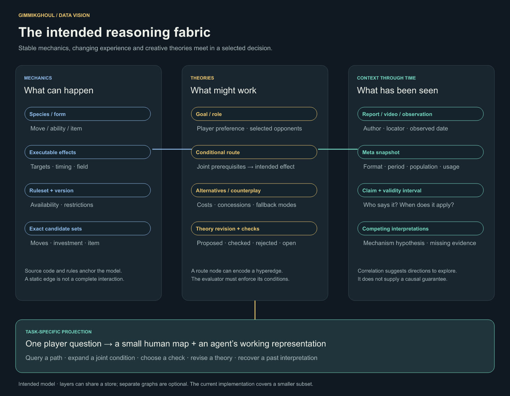

<p align="center"></p>

# Gimmikghoul

**Give a strange team idea somewhere to grow.**

Gimmikghoul is a community experiment in agent-assisted Pokémon teambuilding. Bring an unusual core, a surprising interaction, or a team you cannot quite make work. Explore what enables it, which opponents matter, what it costs, and which alternative preserves the idea.

The ambition is a shared reasoning canvas: people and agents build conditional plans, discover connections across mechanics and team reports, and choose the next useful question. A graph can show those relationships without reducing a team to one synergy score.

[Explore the visual direction](visuals/README.md) · [Research lineage](research/CITATION_TREE.md) · [Current technical walkthrough](workbench/jit/BLOG.md) · [Contribute an idea](CONTRIBUTING.md)

## Gimmikwatch: the Reg M-C meta as a market of plans

**[Read the report](https://shivraj-s-bhatti.github.io/gimmikghoul/)** · [Explore the charts](https://shivraj-s-bhatti.github.io/gimmikghoul/explore.html) · [Thesis and math](https://shivraj-s-bhatti.github.io/gimmikghoul/thesis.html) · [Harness and data](https://shivraj-s-bhatti.github.io/gimmikghoul/data.html)

Why the same six Pokémon went 15-2 and 0-8 at Nice Regionals (2027 season, October 2026), read through 3,004 anonymised open team sheets from Frankfurt, Louisville and Nice. Dictionary learning finds 16 plans players already name. Match records show which plans beat which, including rock-paper-scissors cycles. A plan's change in value between events splits exactly into per-opponent terms, which is how "why now" gets answered.

```sh
npm ci && npm run prepare:data                                       # pinned Showdown Champions engine
node meta/events.mjs                                                 # normalise and anonymise sheets
uv run --with numpy --with scikit-learn python -I meta/plans.py      # plans, matchup model, cycles, map
node meta/cases.mjs && node meta/mechanics.cjs                       # every report number, engine checks
```

| Path | What it is |
|---|---|
| [`meta/`](meta/) | The harness: events → plans → cases → mechanics |
| [`site/`](site/) | The static site, deployed to GitHub Pages on push |
| [`site/data/`](site/data/) | Anonymised teams and matches (CSV, JSON), learned plans, report numbers |
| [`workbench/jit/`](workbench/jit/) | The just-in-time idea graph in FalkorDB |

The numbers were cross-checked in an independent Codex review, which also caught claims the data couldn't support (they're corrected on the site). Limits: Day 1 records only for most comparisons, small samples for the exact six (18 players), and no leads, brought four, spreads or turn logs in open sheets.

## Where we are

The runnable starting point builds a FalkorDB graph around an attributed Alcremie / Mega Garchomp Z team, retrieves move candidates from a pinned Champions engine, and attaches selected native calculator results. A separate file-based theory loop preserves revisions and identifies stale receipts. These are useful pieces of the intended workbench; the full interactive theory system in the storyboards is proposed.

The first experiment has not established a graph advantage, competitive win-rate improvement, or autonomous discovery. The next job is to find which representations actually help players and agents create better ideas. [Research agenda](research/AGENDA.md).

## Try the current experiment

Requires Node 22.18+ and, for the graph, Docker Compose. The catalog and examples are pinned to a September 2026 Champions snapshot; they do not follow today's regulation automatically.

```sh
npm ci
npm test
# Read recorded theory evidence without installing the game engine:
node workbench/theory.mjs read data/theories/memento-staraptor/theory.json
```

For a fresh local installation:

```sh
docker compose --profile explore up -d --build --wait
npm run prepare:data
node workbench/tools/prepare-calculator.mjs
# Step 1 clears ONLY the selected demo graph (default: gk_gimmikghoul).
for step in 1 2 3 4 5 6; do npm run demo:jit -- "$step"; done
node scripts/experiment-sprites.mjs gk_gimmikghoul
```

Open **http://localhost:4319**, choose `gk_gimmikghoul`, and explore:

```cypher
MATCH p=(:Mon)-[:CAN_LEARN]->(:Move)-[:ENABLES]->(:Mon) RETURN p
```

If the earlier Pokémon lab database is already running on ports 6388/4319, reuse it and skip Docker startup. This repo's new graph name keeps the existing `gk_jit` demonstration intact. Database and Browser ports bind to localhost, the DB stays writable, and Docker stores its data in a persistent volume. Do not run `down -v` unless you intend to erase that installation's data.

[Six-step explanation](workbench/jit/README.md) · [Calculator adapters](workbench/tools/README.md) · [Agent connection](workbench/mcp/README.md) · [Revision example](data/theories/memento-staraptor/README.md)

## Intended workbench



A mechanics layer describes what can happen. A temporal layer records which teams and ideas were observed, where, and under which rules. An idea layer connects goals to alternative routes, joint requirements, costs, and counterplay. Agents create temporary projections of that material; a player sees a small, legible map of the decision in front of them.

We can build and use one useful loop at a time. See the [vision](docs/VISION.md) and [two storyboards](visuals/README.md).

## Origins and credits

This project grew out of [Pokémon battle lab](https://github.com/shivraj-S-bhatti/pokemon-battle-lab/tree/6e9aa7d76643d6af3974023d902a647db48a9502). The [import manifest](research/IMPORT_MANIFEST.md) records the starting revision and copied files. The demo attributes its seed team to London Faust, presented by Aaron Zheng. Its source locator is incomplete; finding the exact public video is an open contribution.

We reuse Pokémon Showdown, Smogon's calculator and FalkorDB. Research references and executable dependencies are distinguished in the [citation tree](research/CITATION_TREE.md). Pokémon names and artwork belong to their respective owners; this is an independent fan research project. See [asset attribution](brand/ATTRIBUTION.md).
