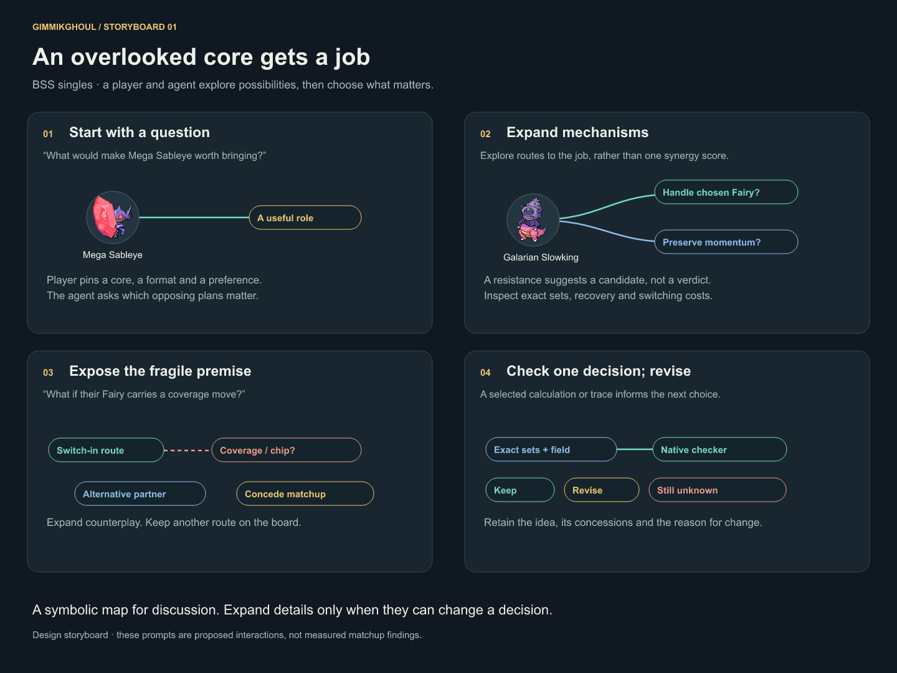
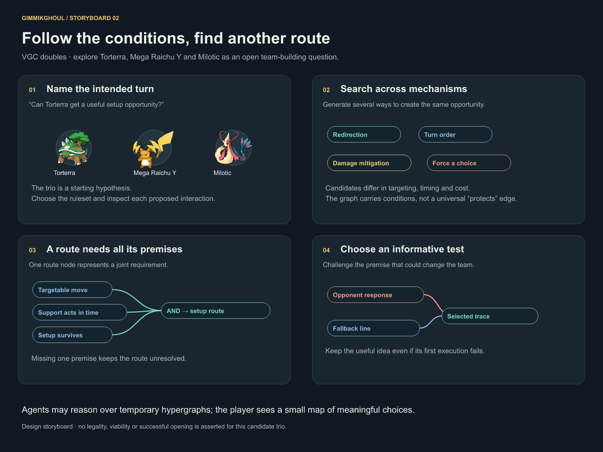

# Visual direction

These boards describe the intended Gimmikghoul experience. They are deliberately broader than today's schema. They are editable SVGs, with a small local gallery to switch between them.

```sh
npm run visuals
# Open http://localhost:4320/visuals/
```

## 1. An overlooked core gets a job



Start from Mega Sableye, explore roles and possible partners, inspect a fragile premise, and choose one useful check. The player keeps control over which matchups matter.

## 2. Follow the conditions, find another route



Start from a doubles setup question. Search across mechanisms, expand joint conditions and compare a fallback. Torterra / Mega Raichu Y / Milotic is an open candidate, not a claimed discovered core.

## 3. The intended reasoning fabric


Mechanics, context over time and theory revisions supply a selected projection for the human and agent. A property graph can represent a joint condition through a route node; the evaluator still has to respect its semantics.

Regenerate with `python3 visuals/render.py`. This changes the three SVG files, not the live database. Sprites are embedded from the attributed local catalog; the mascot lives in `brand/`.

PNG exports are included for sharing. They were rendered from the SVGs with resvg-py 0.5.0; the editable source remains the SVG and generator.
